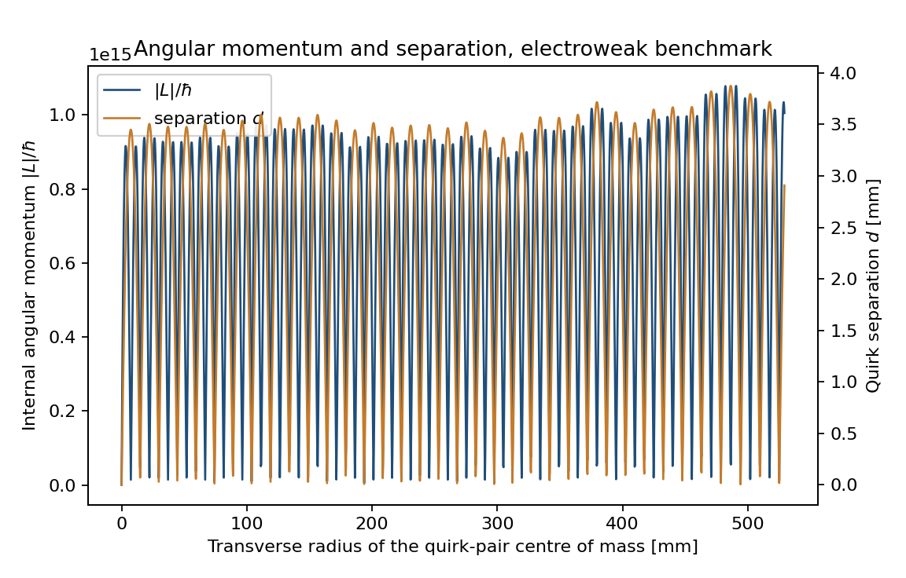
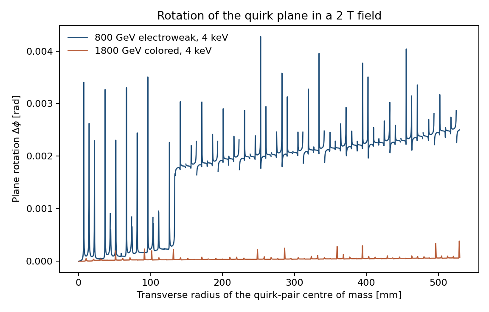
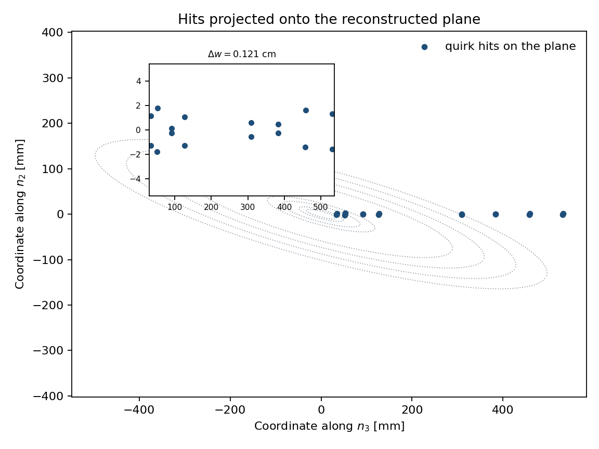
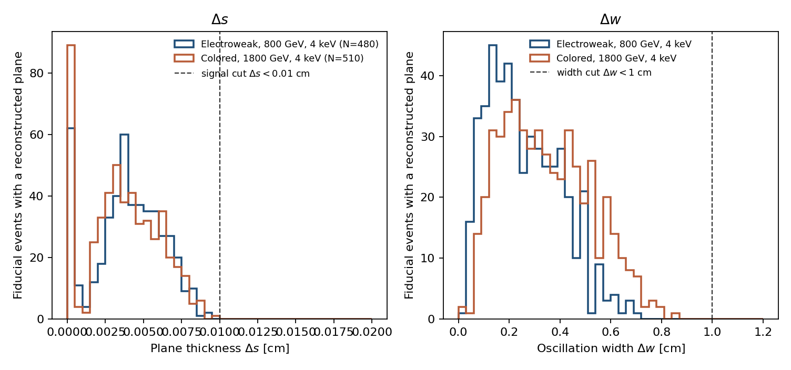

# Quirk plane-search report

Comparison of the 2000-event electroweak and colored samples with Knapen, Lou, Papucci, and Setford, arXiv:1708.02243, Table I, together with Wilson 95% intervals and the analogues of Figures 2–5.

## Samples

Both samples use the straight-string propagator, a 2 T solenoid, and the eight-layer barrel. Each sample has 2000 generated events. The electroweak sample has mass 800 GeV. The colored sample has mass 1800 GeV. Both use a string scale of 4 keV. Momenta come from the built-in sampler. MadGraph and Pythia were not used for these events.

## How the efficiencies are defined

An event is counted in a cut only if it passed every earlier cut. The three efficiencies in the paper are ratios of those counts.

| Efficiency | Definition | Formula |
| --- | --- | --- |
| Trigger | Pair transverse momentum above 200 GeV. | \(\varepsilon_{\mathrm{trig}} = N_{\mathrm{trig}} / N_{\mathrm{gen}}\) |
| Fiducial | Both quirks hit all eight barrel layers, with every hit time under 25 ns. | \(\varepsilon_{\mathrm{fid}} = N_{\mathrm{fid}} / N_{\mathrm{trig}}\) |
| Reconstruction | The plane finder and the final hit pattern both succeed. | \(\varepsilon_{\mathrm{reco}} = N_{\mathrm{reco}} / N_{\mathrm{fid}}\) |
| Total | Product of the three factors. It is also the fraction of all generated events that pass the last cut. | \(\varepsilon = \varepsilon_{\mathrm{trig}}\varepsilon_{\mathrm{fid}}\varepsilon_{\mathrm{reco}}\) |

The reconstruction count is the number of events that pass the hit-pattern cut. Because the flow is sequential, that count already requires the trigger, the fiducial requirement, the seed windows, the factor-of-three growth test, \(\Delta w < 1\,\mathrm{cm}\), and \(\Delta s < 0.01\,\mathrm{cm}\).

## Wilson 95% intervals

Each efficiency is a binomial proportion \(k/n\). The quoted uncertainty is the standard error \(\sqrt{p(1-p)/n}\). The 95% interval is the Wilson score interval,

\[
\left(\hat p + \frac{z^2}{2n}\right)\frac{1}{1+z^2/n}
\;\pm\;
\frac{z}{1+z^2/n}
\sqrt{\frac{\hat p(1-\hat p)}{n}+\frac{z^2}{4n^2}},
\]

with \(z = 1.960\). For a conditional cut, \(k\) is the number passing that cut and \(n\) is the number that reached it.

### Electroweak sample, 800 GeV

| Cut | N pass | N reaching the cut | Efficiency | Standard error | Wilson 95% CI |
| --- | --- | --- | --- | --- | --- |
| generated | 2000 | 2000 | 1.000 | 0.000 | [1.000, 1.000] |
| trigger | 569 | 2000 | 0.284 | 0.010 | [0.265, 0.305] |
| fiducial | 549 | 569 | 0.965 | 0.008 | [0.946, 0.977] |
| seed_pair_layer8 | 515 | 549 | 0.938 | 0.010 | [0.915, 0.955] |
| seed_pair_layer7 | 503 | 515 | 0.977 | 0.007 | [0.960, 0.987] |
| seed_prefilter | 481 | 503 | 0.956 | 0.009 | [0.935, 0.971] |
| seed_delta_s | 481 | 481 | 1.000 | 0.000 | [0.992, 1.000] |
| seed_delta_w | 480 | 481 | 0.998 | 0.002 | [0.988, 1.000] |
| seed_forward | 480 | 480 | 1.000 | 0.000 | [0.992, 1.000] |
| inward_walk | 480 | 480 | 1.000 | 0.000 | [0.992, 1.000] |
| final_delta_s | 480 | 480 | 1.000 | 0.000 | [0.992, 1.000] |
| hit_pattern | 338 | 480 | 0.704 | 0.021 | [0.662, 0.743] |

| Efficiency | Count | Estimate | Standard error | Wilson 95% CI |
| --- | --- | --- | --- | --- |
| Trigger | 569 / 2000 | 0.284 | 0.010 | [0.265, 0.305] |
| Fiducial | 549 / 569 | 0.965 | 0.008 | [0.946, 0.977] |
| Reconstruction | 338 / 549 | 0.616 | 0.021 | [0.574, 0.655] |
| Total | 338 / 2000 | 0.169 | 0.008 | [0.153, 0.186] |

### Colored sample, 1800 GeV

| Cut | N pass | N reaching the cut | Efficiency | Standard error | Wilson 95% CI |
| --- | --- | --- | --- | --- | --- |
| generated | 2000 | 2000 | 1.000 | 0.000 | [1.000, 1.000] |
| trigger | 895 | 2000 | 0.448 | 0.011 | [0.426, 0.469] |
| fiducial | 556 | 895 | 0.621 | 0.016 | [0.589, 0.652] |
| seed_pair_layer8 | 533 | 556 | 0.959 | 0.008 | [0.939, 0.972] |
| seed_pair_layer7 | 519 | 533 | 0.974 | 0.007 | [0.956, 0.984] |
| seed_prefilter | 518 | 519 | 0.998 | 0.002 | [0.989, 1.000] |
| seed_delta_s | 518 | 518 | 1.000 | 0.000 | [0.993, 1.000] |
| seed_delta_w | 510 | 518 | 0.985 | 0.005 | [0.970, 0.992] |
| seed_forward | 510 | 510 | 1.000 | 0.000 | [0.993, 1.000] |
| inward_walk | 510 | 510 | 1.000 | 0.000 | [0.993, 1.000] |
| final_delta_s | 510 | 510 | 1.000 | 0.000 | [0.993, 1.000] |
| hit_pattern | 340 | 510 | 0.667 | 0.021 | [0.625, 0.706] |

| Efficiency | Count | Estimate | Standard error | Wilson 95% CI |
| --- | --- | --- | --- | --- |
| Trigger | 895 / 2000 | 0.448 | 0.011 | [0.426, 0.469] |
| Fiducial | 556 / 895 | 0.621 | 0.016 | [0.589, 0.652] |
| Reconstruction | 340 / 556 | 0.612 | 0.021 | [0.570, 0.651] |
| Total | 340 / 2000 | 0.170 | 0.008 | [0.154, 0.187] |

## Comparison with Table I

Table I lists the electroweak efficiencies at 800 GeV and the colored efficiencies at 1800 GeV. Trigger and fiducial efficiencies in that table do not depend on the string scale. The reconstruction efficiency does. This run is at 4 keV for both samples. Table I gives the electroweak reconstruction efficiency at 4 keV. It does not give a colored row at 4 keV; the neighboring colored entries are 0.59 at 3 keV and 0.74 at 5 keV.

| Sample | Efficiency | Table I | This work | Standard error | Wilson 95% CI | Table I versus this interval |
| --- | --- | --- | --- | --- | --- | --- |
| Electroweak, 800 GeV | Trigger | 0.10 | 0.284 | 0.010 | [0.265, 0.305] | The Table I value 0.10 lies outside this interval. |
| Electroweak, 800 GeV | Fiducial | 0.28 | 0.965 | 0.008 | [0.946, 0.977] | The Table I value 0.28 lies outside this interval. |
| Electroweak, 800 GeV | Reconstruction | 0.72 | 0.616 | 0.021 | [0.574, 0.655] | The Table I value 0.72 lies outside this interval. |
| Colored, 1800 GeV | Trigger | 0.24 | 0.448 | 0.011 | [0.426, 0.469] | The Table I value 0.24 lies outside this interval. |
| Colored, 1800 GeV | Fiducial | 0.28 | 0.621 | 0.016 | [0.589, 0.652] | The Table I value 0.28 lies outside this interval. |
| Colored, 1800 GeV | Reconstruction | 0.59 at 3 keV; 0.74 at 5 keV | 0.612 | 0.021 | [0.570, 0.651] | The paper does not tabulate this entry at 4 keV. |

Electroweak counts are 569 triggered, 549 fiducial, and 338 reconstructed, out of 2000. Colored counts are 895 triggered, 556 fiducial, and 340 reconstructed, out of 2000.

The trigger and fiducial values sit far from Table I. Those two efficiencies are properties of the momentum distribution. This run uses the built-in sampler, while Table I uses MadGraph and Pythia, so the difference is expected. The reconstruction efficiency uses the same plane cuts. For the electroweak sample the Table I value 0.72 can be compared directly with the Wilson interval above.

## Figures

### Figure 2

Internal angular momentum and quirk separation for one electroweak event at 800 GeV and 4 keV in a 2 T field. The maximum \(|L|/\hbar\) on the tracked trajectory is 1.078e+15, and the separation stays between 0.001 mm and 3.874 mm. This is the same pair of quantities as Figure 2 of the paper, for this benchmark rather than for their unpublished representative event.

### Figure 3

Angle between the instantaneous quirk plane and the plane at the start of the trajectory. The electroweak curve reaches 4.277e-03 rad. The colored curve, at 1800 GeV and 4 keV, reaches 3.830e-04 rad. The paper's Figure 3 shows this rotation for two benchmark events and finds it small compared with the tracker resolution.

### Figure 4

Hits of one electroweak event projected onto the reconstructed plane, with the eight barrel layers drawn as dotted curves. The fitted thickness is \(\Delta s = 0.0027\,\mathrm{cm}\) and the fitted width is \(\Delta w = 0.1214\,\mathrm{cm}\), from 16 hits. The inset is the strip, as in Figure 4 of the paper.

### Figure 5

Thickness and width for fiducial events in which the plane finder returned a plane, before requiring the final hit pattern. The dashed line on the left is the signal cut \(\Delta s < 0.01\,\mathrm{cm}\). The dashed line on the right is \(\Delta w < 1\,\mathrm{cm}\). The paper's Figure 5 also shows the pileup and photon-conversion background. Those background samples were not part of this 2000-event generation, so this figure shows the two signal samples only. The paper's colored curve is at 2 keV; the colored curve here is the 4 keV sample that was generated.

## Files

The input summaries are `cutflow_dy_800_lambda4000_n2000.json`, `cutflow_dy_800_lambda4000_n2000_events.csv`, `cutflow_qcd_1800_lambda4000_n2000.json`, and `cutflow_qcd_1800_lambda4000_n2000_events.csv`.

